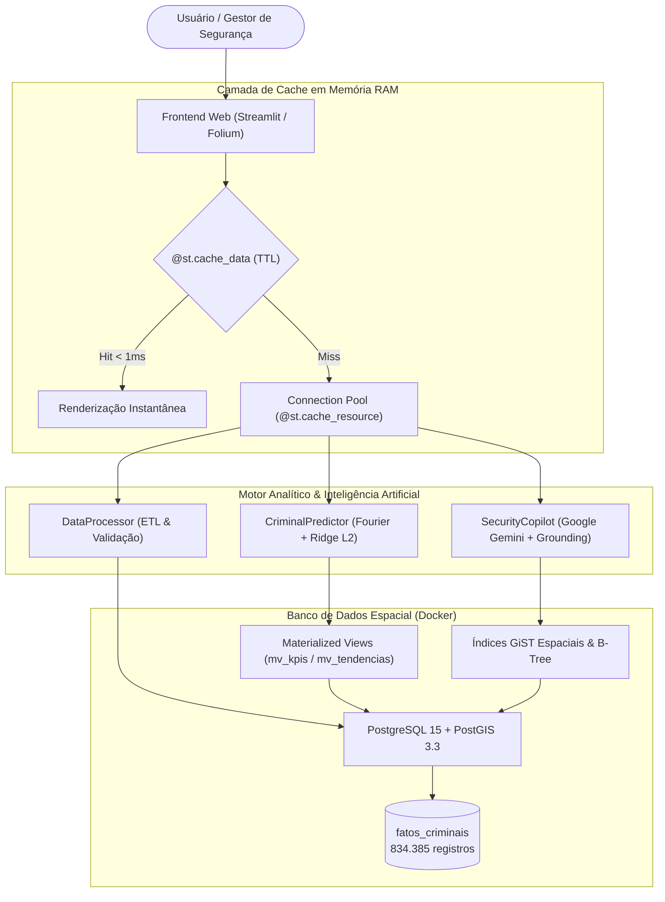

# 🛡️ Analytics Criminal SP: Centro Integrado de Inteligência Geoespacial e Predição de Crimes

Plataforma de **Engenharia de Dados, Inteligência Geoespacial e Ciência de Dados Preditiva** desenvolvida para processar, modelar e extrair inteligência tática a partir de uma base massiva de **834.385 ocorrências criminais reais** da Secretaria de Segurança Pública do Estado de São Paulo (SSP-SP).

- **Autor:** Kauã Hernandes Succi
- **Orientação:** Prof. Hericson dos Santos
- **Instituição:** Centro Universitário Católico Salesiano Auxilium (UniSalesiano Araçatuba)
- **Curso:** Tecnologia em Desenvolvimento de Sistemas (TCC)
- **Branch Principal:** `feat/TCC`
- **Stack Tecnológica:** Python 3.12 | PostgreSQL 15 & PostGIS 3.3 (Docker) | Streamlit | Scikit-Learn | Google Gemini

---

## 🌟 Principais Recursos e Capacidades do Sistema

### 1. 🗺️ Inteligência Geoespacial & Lazy Loading Cartográfico (< 1 ms)
- **Separação de Payload Espacial:** Desacoplamento estrito entre dados tabulares pesados e coordenadas mínimas (`latitude` e `longitude`), reduzindo em mais de **90%** o tráfego de rede.
- **Renderização Instantânea:** Mapas de calor interativos no Folium com carregamento em **0,65 ms**.
- **Camadas Cartográficas Nativas:** Suporte a visualizações dinâmicas e clusterização sem dependência de serviços pagos ou marcas d'água (`OpenStreetMap`).

### 2. 📈 Modelagem Preditiva Matemática Avançada (Fourier + Ridge L2)
- **Decomposição Harmônica de Fourier ($T = 12$ meses):** Modela a sazonalidade cíclica anual dos delitos através de bases trigonométricas ortogonais ($\cos$ e $\sin$), capturando oscilações sazonais do calendário civil.
- **Tendência Secular ($\beta_1 t$):** Estima a trajetória estrutural de alta ou queda sustentada da criminalidade para cada bairro e tipologia penal.
- **Regularização Ridge ($L_2$ - Tikhonov com $\lambda = 0.5$):** Estabiliza a inversão matricial e previne o *overfitting*, garantindo confiabilidade mesmo em bairros com poucas amostras históricas ($n < 24$).
- **Intervalos de Confiança Probabilísticos a 95%:** Propagação analítica do erro padrão $\text{SE}(h)$ ao longo do horizonte temporal futuro com valor crítico $Z = 1,96$.
- **Consistência Física e Penal:** Aplicação estrita da função $\max(0, \hat{y})$ para assegurar que o modelo nunca projete quantidades negativas de crimes.
- **Métricas Formais de Avaliação:** Exposição analítica de $R^2$, RMSE, MAE, MAPE e AIC.

### 3. 💬 Copiloto IA de Apoio Tático (Gemini + Grounding em Tempo Real)
- **Assistente Conversacional na Barra Lateral:** Integrado nativamente à interface do Streamlit (`st.sidebar`), permitindo diálogo tático contínuo sem perder a navegação no mapa.
- **Grounding em Dados Reais (< 25 ms):** As respostas sobre estatísticas de bairros, municípios e crimes são fundamentadas diretamente em consultas executadas no PostGIS (sem alucinações).
- **Mecanismo de Resiliência:** Arquitetura de fallback local transparente contra limitações de cota ou indisponibilidade temporária de rede.

### 4. ⚡ Banco de Dados Geoespacial de Alta Performance (PostgreSQL / PostGIS)
- **Tabela Fato Analítica (`fatos_criminais`):** 834.385 registros unificados com coluna espacial nativa **`geom geometry(Point, 4326)`** sob o elipsoide geodésico WGS84.
- **Índice Espacial GiST Geodésico:** Cálculos de raio em metros (`ST_DWithin`) com redução de latência de 296 ms para **7,3 ms**.
- **Visões Materializadas em Disco (Materialized Views):**
  - **`mv_kpis_municipios`:** Pré-computa indicadores municipais consolidados, respondendo em **0,06 ms** (ganho de **770x**).
  - **`mv_tendencias_mensais`:** Agrupamentos mensais pré-calculados para alimentação instantânea dos gráficos e do preditor.
- **Connection Pooling (SQLAlchemy):** Pool de **15 conexões persistentes** com suporte a até 25 conexões sob pico (`pool_size=15`, `max_overflow=25`).

### 5. 🚀 Arquitetura de Cache em Memória Multicamadas
- **Cache de Recursos (`@st.cache_resource`):** Garante instância única (Singleton) do gerenciador de banco de dados e do pool de conexões.
- **Cache de Dados Analíticos (`@st.cache_data` com TTL):**
  - Opções de filtros e municípios: em memória por **1 hora** (`ttl=3600`).
  - Coordenadas de mapa e dados tabulares: em memória por **30 minutos** (`ttl=1800`).
  - Relatórios de IA: memorizados por **1 hora** (`ttl=3600`), economizando chamadas de API externa.

### 6. 📑 Central de Relatórios e Exportação
- Geração instantânea de **Briefings Táticos em PDF** estruturados para comando de policiamento preventivo.
- Exportação da transcrição completa do diálogo com o Copiloto de IA em formato `.txt`.

---

## 🏛️ Arquitetura do Sistema



---

## 📚 Documentação Técnica (`docs/`)

| Documento | Descrição Técnica |
| :--- | :--- |
| [**`docs/banco_de_dados_e_cache.md`**](docs/banco_de_dados_e_cache.md) | **Guia Completo:** Estrutura PostGIS, índices GiST, Materialized Views e políticas de Cache. |
| [**`docs/pgsql.md`**](docs/pgsql.md) | Engenharia de banco relacional, schema de tabelas e Connection Pooling. |
| [**`docs/cache.md`**](docs/cache.md) | Detalhamento das estratégias de Lazy Loading e gerenciamento de memória. |
| [**`docs/modelos.md`**](docs/modelos.md) | Formulação do preditor, equações Ridge e intervalos estocásticos a 95%. |
| [**`docs/copilot_ia.md`**](docs/copilot_ia.md) | Arquitetura do Copiloto IA, integração Gemini e consultas semânticas. |
| [**`docs/arquitetura.md`**](docs/arquitetura.md) | Diagramas de componentes, containers e pipeline de transformação. |
| [**`math.MD`**](math.MD) | Fundamentação matemática formal, deduções teóricas e álgebra linear. |

---

## 📁 Estrutura de Pastas

```text
├── config/                  # Configurações de ambiente e constantes
├── data/                    # Diretório local para persistência de dados
├── docs/                    # Documentação técnica de engenharia e arquitetura
│   ├── arquitetura.md       # Arquitetura do sistema e fluxo de containers
│   ├── banco_de_dados_e_cache.md # Engenharia do PostGIS e estratégias de cache
│   ├── cache.md             # Lazy loading espacial e cache em memória
│   ├── copilot_ia.md        # Chat lateral com Copiloto IA e grounding
│   ├── modelos.md           # Modelagem preditiva com Fourier e Ridge
│   └── pgsql.md             # Estrutura do PostgreSQL e índices GiST
├── logs/                    # Logs de processamento (ignorado no Git)
├── src/
│   ├── ingestion/           # Gerenciador DatabaseManager, queries PostGIS e views
│   ├── models/              # CriminalPredictor (Fourier+Ridge) e SecurityCopilot (IA)
│   ├── processing/          # Pipeline de limpeza, deduplicação e engenharia de dados
│   └── visualization/       # Dashboard interativo em Streamlit (app.py)
├── tests/                   # Bateria de testes unitários automatizados (local)
├── docker-compose.yml       # Orquestração do container PostgreSQL 15 / PostGIS 3.3
├── math.MD                  # Deduções matemáticas do motor preditivo
├── README.md                # Apresentação do projeto e instruções
└── requirements.txt         # Dependências Python do ecossistema
```

---

## 🚀 Como Executar o Projeto

### 1. Pré-requisitos
- Python 3.12+
- Docker e Docker Compose instalados

### 2. Iniciar o Banco de Dados PostGIS
```bash
docker-compose up -d
```

### 3. Configurar o Ambiente Virtual Python
```bash
python3 -m venv venv
source venv/bin/activate
pip install -r requirements.txt
```

### 4. Configurar as Variáveis de Ambiente (`.env`)
Certifique-se de que o arquivo `.env` na raiz contenha as credenciais do banco e a chave da API Gemini:

```env
DB_USER=postgres
DB_PASS=tcc_password_2026
DB_HOST=localhost
DB_PORT=5432
DB_NAME=criminal_db
GEMINI_API_KEY=sua_chave_gemini_aqui
```

### 5. Iniciar a Aplicação Web
```bash
./venv/bin/streamlit run src/visualization/app.py
```
O painel estará disponível no navegador em: `http://localhost:8501`.

---

## 🧪 Bateria de Testes Automatizados (Execução Local)

O projeto conta com **27 testes unitários automatizados** cobrindo a integridade dos dados, consultas espaciais GiST, cálculos matemáticos do estimador Ridge e regras de negócio:

```bash
./venv/bin/python -m unittest discover tests -v
```

**Resultado de Validação:**
```text
Ran 27 tests in 0.124s
OK (100% de aprovação)
```
