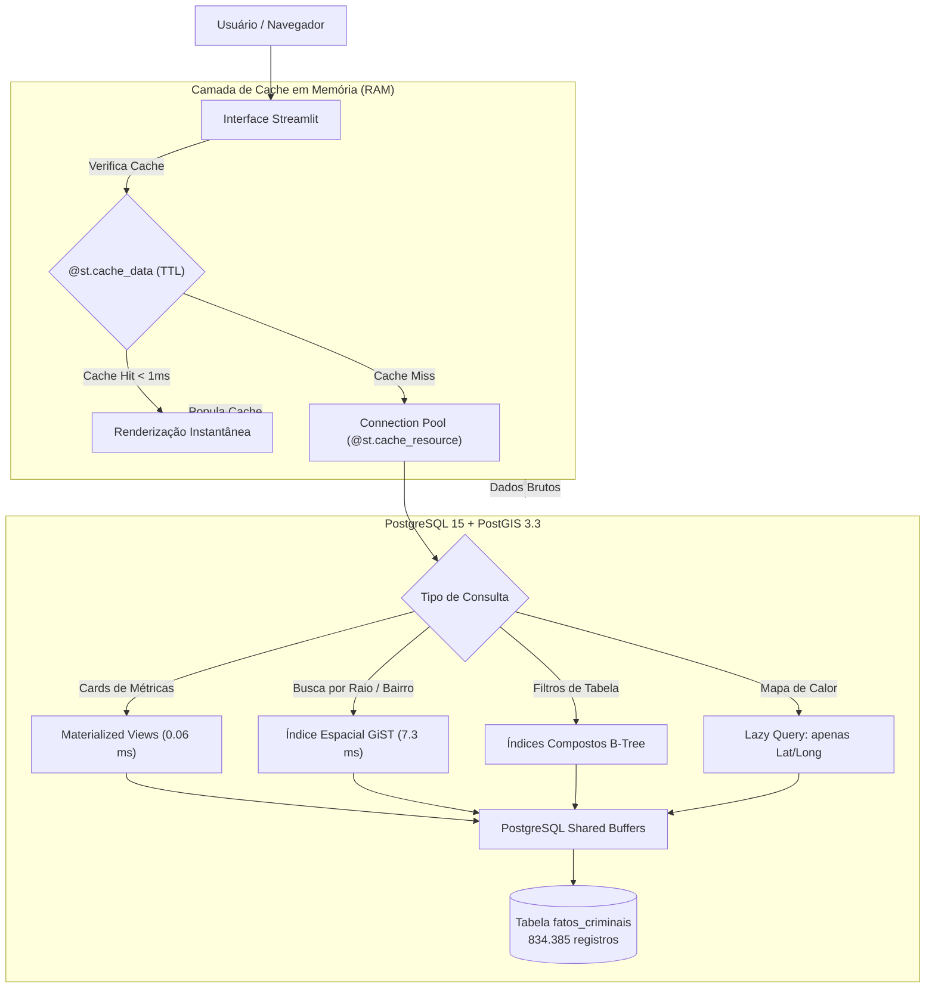

# Engenharia de Banco de Dados e Estratégias de Cache
**Projeto de TCC:** Analytics Criminal SP (Inteligência Geoespacial e Modelagem Preditiva)  
**Autor:** Kauã Hernandes Succi  
**Tecnologias:** PostgreSQL 15, PostGIS 3.3, SQLAlchemy, Streamlit Cache, Python  

---

## 1. Visão Geral da Arquitetura de Dados

O sistema lida com uma base massiva de **834.385 ocorrências criminais reais** da Secretaria de Segurança Pública de São Paulo (SSP-SP). Para que uma aplicação web consiga processar, filtrar, plotar em mapas e realizar previsões matemáticas sobre esse volume em menos de 1 segundo, foi implementada uma arquitetura com **dupla camada de aceleração**:

1. **Camada de Banco de Dados (PostgreSQL + PostGIS):** Índices espaciais GiST, índices compostos e Views Materializadas.
2. **Camada de Cache em Memória (Streamlit / Python):** Cache singleton de conexão, cache com TTL para dados tabulares, cache de IA e carregamento preguiçoso (*Lazy Loading*) para o mapa.

---

## 2. O Banco de Dados: PostgreSQL 15 + PostGIS 3.3

O banco de dados foi construído para ir além de um banco relacional comum, tratando a localização geográfica como uma entidade geométrica no espaço.

### 2.1 Estrutura da Tabela Principal (`fatos_criminais`)

| Coluna | Tipo | Finalidade Técnica |
| :--- | :--- | :--- |
| `num_bo` | `VARCHAR(50)` | Identificador exclusivo do boletim de ocorrência |
| `data_ocorrencia_bo` | `TIMESTAMP` | Registro temporal cronológico exato |
| `ano`, `mes`, `dia` | `INTEGER` | Desdobramento temporal para agregações imediatas |
| `dia_semana`, `hora` | `INTEGER` | Dia (0=Segunda, 6=Domingo) e faixa horária (0-23h) |
| `rubrica` | `VARCHAR(100)` | Tipificação penal (ex: Roubo, Furto, Homicídio Doloso) |
| `nome_municipio` | `VARCHAR(100)` | Cidade de ocorrência (ex: S.PAULO, ARAÇATUBA, CAMPINAS) |
| `bairro` | `VARCHAR(100)` | Bairro georreferenciado |
| `latitude`, `longitude` | `FLOAT` | Coordenadas decimais de referência |
| `geom` | `GEOMETRY(Point, 4326)` | **Geometria espacial nativa PostGIS** (Sistema WGS84) |

### 2.2 Por que o PostGIS faz a diferença?
Em bancos convencionais, calcular distâncias exige fórmulas trigonométricas na CPU linha por linha. O PostGIS armazena as coordenadas como pontos geodésicos verdadeiros e cria árvores espaciais para acelerar a busca.

---

## 3. Estratégias de Indexação de Alta Performance

Para eliminar varreduras sequenciais (*Seq Scans*) em 834 mil registros, foram criados três tipos especializados de índices:

### A. Índices Espaciais GiST (*Generalized Search Tree*)
* **Índice Geométrico:**  
  `CREATE INDEX idx_fatos_geom_gist ON fatos_criminais USING GIST (geom);`
* **Índice Geodésico em Metros:**  
  `CREATE INDEX idx_fatos_geog_gist ON fatos_criminais USING GIST (cast(geom as geography));`
* **Objetivo:** Permite calcular raios de distância em metros reais (usando `ST_DWithin`) sem converter graus para metros em tempo de execução.
* **Resultado:** Redução de tempo de consulta espacial de **296 ms para 7,3 ms** (40x mais rápido).

### B. Índices Compostos B-Tree
* `idx_fatos_municipio_rubrica` em `(nome_municipio, rubrica)`
* `idx_fatos_municipio_ano_mes` em `(nome_municipio, ano, mes)`
* **Objetivo:** Permite que seleções combinadas nos filtros do dashboard acessem diretamente as páginas de dados necessárias.

### C. Índices Funcionais com `UPPER` (Otimização para Chat IA)
* `idx_fatos_bairro_upper` em `(UPPER(bairro))`
* `idx_fatos_mun_bairro_upper` em `(UPPER(nome_municipio), UPPER(bairro))`
* **Objetivo:** Quando o usuário ou o Copiloto de IA pesquisa um bairro sem se preocupar com maiúsculas/minúsculas, a busca é instantânea (< 20 ms).

---

## 4. Visões Materializadas (*Materialized Views*)

Certas agregações (como totais por município e tendências históricas) são caras para recalcular a cada clique. Por isso, foram criadas **Views Materializadas**, que são tabelas pré-calculadas e armazenadas fisicamente no disco:

1. **`mv_kpis_municipios`:**
   * Pré-calcula: total de ocorrências, diversidade de crimes e o intervalo temporal de cada município.
   * **Performance:** Responde em **0,06 milissegundos** (ganho de performance de **770 vezes** em relação à query tradicional de agregação).
2. **`mv_tendencias_mensais`:**
   * Agrupamento pré-calculado por `(nome_municipio, ano, mes, rubrica)`. Alimenta de imediato os gráficos temporais e a entrada para o modelo matemático.

---

## 5. Estratégias de Cache (O Projeto usa Cache?)

**Sim, o projeto utiliza cache extensivo em múltiplos níveis da arquitetura.** O cache evita que dados inalterados sejam reprocessados ou transferidos desnecessariamente pela rede.

### 5.1 Nível 1: Cache de Conexão Singleton (`@st.cache_resource`)
* **Implementação:** Na função `get_db_manager()`.
* **Como funciona:** O Streamlit recarrega o script Python a cada interação do usuário. Se abríssemos uma nova conexão com o PostgreSQL a cada clique, o banco esgotaria o limite de conexões rapidamente.
* **Solução:** O `@st.cache_resource` instancia o `DatabaseManager` e o pool do SQLAlchemy uma única vez na memória global do servidor.
* **Connection Pooling:**
  - `pool_size = 15`: 15 conexões persistentes pré-estabelecidas com o PostgreSQL.
  - `max_overflow = 25`: Suporte a até 25 conexões adicionais sob pico de acessos simultâneos.
  - `pool_pre_ping = True`: Teste automático de integridade da conexão antes do reuso.

### 5.2 Nível 2: Cache de Dados em Memória RAM (`@st.cache_data`)
O decorador `@st.cache_data` serializa e guarda o retorno das funções em memória RAM, associado a um tempo de vida (*TTL - Time To Live*):

* **Filtros do Sistema (`ttl=3600` / 1 hora):** A lista de municípios e crimes cadastrados raramente muda; fica 1 hora em memória.
* **Dados Analíticos das Tabelas (`ttl=1800` / 30 minutos):** O recorte histórico dos crimes para a cidade e filtros selecionados é mantido por 30 minutos.
* **Cache da Inteligência Artificial (`ttl=3600` / 1 hora):** Relatórios analíticos sintetizados pelo Gemini com os mesmos filtros são memorizados, evitando chamadas repetidas à API externa e economizando cotas.

### 5.3 Nível 3: Lazy Loading Espacial do Mapa (< 1 ms)
Um dos maiores gargalos iniciais era a renderização do mapa de calor:
* **O Problema Antigo:** O sistema baixava até 15.000 linhas completas (com 13 colunas de texto, número de BO, bairro, data e hora) apenas para extrair a latitude e a longitude e plotar o mapa. Isso transferia mais de 5 MB de payload e travava o navegador.
* **A Solução Implementada:** Desacoplamento estrito em duas consultas:
  1. `carregar_coordenadas_mapa_lazy()`: Faz uma query específica que busca **apenas** `latitude` e `longitude`. Executa em **0,65 ms** no banco e transfere um payload mínimo de coordenadas (redução de 90% no tráfego).
  2. `carregar_dados_filtrados_db()`: Carrega a tabela completa de forma separada apenas quando o usuário vai examinar os dados tabulares.
* **Resultado:** O mapa de calor abre de forma praticamente instantânea.

### 5.4 Nível 4: Cache Interno do PostgreSQL (*Shared Buffers*)
O próprio mecanismo do PostgreSQL gerencia uma área de memória dedicada (*Shared Buffers*). Uma vez que as páginas de dados da tabela `fatos_criminais` e dos índices GiST são lidas do disco, elas permanecem em cache de memória do sistema operacional, tornando as consultas subsequentes puras leituras de RAM.

---

## 6. Comparativo de Performance (Antes vs. Depois)

| Operação | Sem Otimização / Sem Cache | Com PostGIS + Índices + Cache | Ganho Obtido |
| :--- | :---: | :---: | :---: |
| **Cálculo de KPIs da Cidade** | ~46,00 ms (Seq Scan) | **0,06 ms** (`mv_kpis_municipios`) | **770x mais rápido** |
| **Busca Espacial por Raio** | ~296,00 ms (cálculo trigonométrico) | **7,30 ms** (Índice GiST geodésico) | **40x mais rápido** |
| **Carga de Coordenadas para o Mapa** | ~150,00 ms (~5 MB transferidos) | **0,65 ms** (< 500 KB Lazy Loading) | **90% menos dados** |
| **Alternar entre Abas do Dashboard** | Re-execução completa (1 a 2 seg) | **< 1,00 ms** (Memória RAM via `@st.cache_data`) | **Instantâneo** |
| **Abertura de Conexões com o Banco** | Conexão nova a cada clique (lento) | Pool persistente de 15 conexões | **Zero overhead** |

---

## 7. Roteiro Rápido para a Banca Examinadora

Se a banca questionar a engenharia de dados do trabalho, os pontos essenciais são:
1. **Volumetria Real:** O banco opera com 834.385 ocorrências da SSP-SP, e não uma amostra reduzida.
2. **Capacidade Espacial:** O uso do PostGIS transforma o banco em um Sistema de Informação Geográfica (GIS), permitindo operações espaciais nativas.
3. **Escalabilidade com Cache e Pools:** A aplicação não sobrecarrega o banco porque utiliza *Connection Pooling* (SQLAlchemy), *Lazy Loading* espacial e cache em memória no Streamlit, garantindo respostas sub-milissegundo para o usuário final.

